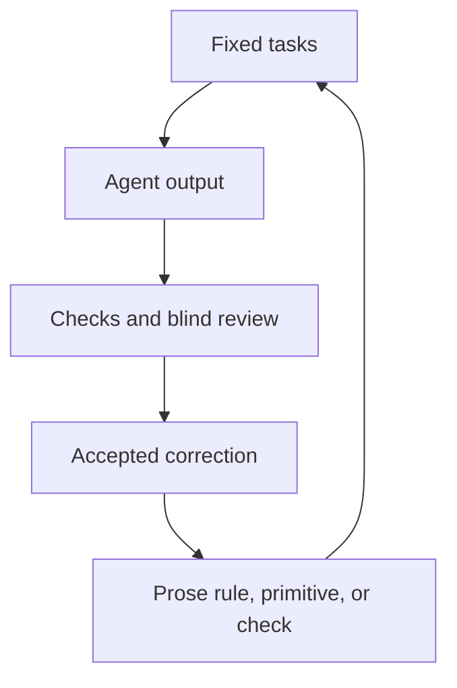

An eval runs a fixed set of tasks through an agent and checks what comes back against your system. It's the only way to know whether your `AGENTS.md`, skills, and docs actually help. [Trueman](https://blog.murphytrueman.com/design-systems-need-evals/) describes it as "a test for output you can't predict." When Southleft measured its own projects, some of the agent files turned out to be making the output worse.

:::tip[Key takeaways]
- **Run a bare baseline before trusting agent files.** Without one, you can't tell whether your guidance helps or quietly hurts.
- **Score mechanics and judgment separately.** Code can pass every API and token check and still be the wrong design.
- **Have people judge the rendered pages.** Model graders reading code miss visual failures and drift from what people prefer.
:::

## The problem

Agent files are prompts. They tell an agent what your system is and how to use it, but nothing in them reports back on whether it listened.

> "You can write the cleanest AGENTS.md on the internet and still have no idea whether the component that shipped this morning came from your library, or got hand-rolled as a div with a hardcoded blue." — [Murphy T.](https://blog.murphytrueman.com/design-systems-need-evals/)

The ground also keeps moving. Trueman points out that a model update can change how an agent treats your tokens while your rules sit untouched, and someone trimming three lines from `AGENTS.md` can break a behavior nobody re-tests. Guidance can also do harm on its own. [Cris Morales](https://southleft.com/insights/design-systems/what-does-ai-readiness-mean-in-design-systems/) found agents scored higher reading the bare codebase than reading Southleft's agent files, because the files hardcoded component and token lists that had gone stale. Some even held "ghost tokens" that the agent which wrote the file had made up.

## Practices

### Write tasks the way your team asks

Trueman's rule for eval prompts is that they "should read like the ones your team actually types, underspecified and intent-level." If the prompt names the component, the eval only shows the agent can follow orders, not whether your system steers it there. Christoph Hellmuth's [Open Design System Bench](https://github.com/christophhdesign/open-design-system-bench) (ODSB), a benchmark that runs coding agents against a React component library, follows this: each task's expected components are hidden from the agent and shown only to the grader.

Morales found the bench's starter tasks too mechanical to test design guidance, so [he wrote briefs](https://southleft.com/insights/design-systems/the-autonomy-vs-alignment-dial-for-ai/) closer to real product work, like a workspace settings page where "saving changes should feel safe, and deleting should be hard to do by accident." Vercel [built its tasks](https://vercel.com/blog/how-our-agents-build-on-brand-pages-with-design-md) from real use cases, seven prompts paired with mock data and frozen with their render settings, so the guidance was the only thing that changed between runs.

### Run a bare baseline first

Before you can say a file helps, you need a run without it. ODSB runs the same tasks at three context levels, from nothing to `AGENTS.md` to skills and docs, and reports the lift as the guided score minus the bare score. Vercel's advice for teams starting out is the same: generate the page once with no new design context, and keep that first output even if it looks rough. "You cannot tell whether new context helped without a before."

The baseline is how Southleft caught its own problem. Morales cut one `AGENTS.md` from about 7,000 lines to 700. His first cut dropped the score from 90 to 72, because it removed a prop list without pointing the agent to the auto-generated contract that already existed. Once it did, the score returned to 90, and token cost fell by about 41% and run time by about 22%. Those figures come from Southleft's own projects, not a general benchmark. [Context engineering](/ds101/context-engineering/) covers how to structure the files themselves.

### Score mechanics and judgment separately

Trueman splits every eval into two kinds of check. Mechanical checks confirm the agent used real props, resolved every value to a token, and reached for a library component instead of hand-rolled markup. Judgment checks ask whether it picked the right component for the intent and handled the empty and error states. ODSB scores five mechanical dimensions (imports, API fidelity, token discipline, static accessibility, compiling) against a catalog extracted from source, never hand-written, and gives judgment 30% of the weight.

Trueman's example, trimmed, uses promptfoo, an eval tool. One case pairs a code check against the system with rubrics for a judge model:

```yaml title="evals.yaml (one case)"
tests:
  - vars:
      prompt: >-
        Add a confirmation before
        someone deletes their account.
    assert:
      - type: javascript
        value: file://validate.js
      - type: llm-rubric
        value: >-
          Reaches for the confirmation
          dialog over a generic modal
```

The `javascript` check is the one you write yourself against your own components and tokens. The `llm-rubric` lines cover calls no parser can make.

Keeping the two apart tells you where a fix belongs. Southleft's lowest task was a password field with a show/hide button. Every mechanical check passed and judgment scored 30, because the text input had no slot for the button and agents built their own. More documentation didn't move it. "A missing API is not a documentation gap, the fix lives in the component," as Morales puts it (see [Build the rule into the component](/ds101/documentation-for-agents/#build-the-rule-into-the-component)).

### Have people judge rendered pages, blind

Judgment has to be checked on what the agent built, not only on its code. Morales's judge model graded code structure even when screenshots were provided. When he re-graded with two models given a visual pass, both caught headings that were nearly invisible on an inverted color scheme, and one found a progress value rendering as 6200%. ODSB added a screenshot gallery in October 2026 for the same reason: "A cell that scores 81 and renders an empty page is finally visible as such."

Model graders still aren't the final word. Trueman says a judge model "tracks human judgement well on narrow checks and gets shakier once the calls become subjective," which earns it a place in the suite "without making it the last word on taste." Southleft's experiment shows why people need to be blind too. Morales preferred the principle-based guidance in 13 of 15 blind pairs. A panel of 19 reviewers found no overall winner, and on one task they went the other way, 50 to 30. Even the person who wrote the guidance isn't a reliable judge of it.

Vercel's review app covers both: it shows full-page renders of every run and runs blind A/B comparisons. Shuffle the new output with the baseline and score both against a short rubric without knowing which is which. Vercel's rule is to keep final changes human-reviewed "however far you take the automation."

### Turn each correction into a rule or a check

An eval only pays off when its findings change the system. Vercel puts each accepted correction "in the narrowest place that can consistently enforce it": judgment goes into the design guidance as prose, reusable mechanics into the shared stylesheet, and anything checkable into a deterministic test. A failure that only one model makes stays out of the rules until it repeats.

<div class="mermaid-wrap">



</div>

Morales describes the same loop as "output > eval > signal > rule > start again." In his panel, both model graders flagged solid remove buttons competing for attention, which became the rule "a destructive action is never more prominent than the primary decision." Vercel measured whether its encoded rules held: pages built with the guidance had 39 known failures against 91 without it. Vercel warns that six pages is "far too small a sample" to say anything about overall quality. The test only shows that a failure, once named and encoded, tends to stay gone.

### Run the suite on every change

Trueman's case for a suite over a one-off check is that a regression suite "checks every time, on every change." His example: a pull request renames a prop on the dialog component, and six of twelve prompts come back with the old name because the Code Connect mapping wasn't updated. The PR doesn't merge until it's fixed. ODSB sizes runs to match: a small weekly run against a frozen quarterly baseline, failing CI on a drop of more than five points. If too many cells errored, it reports the run as inconclusive, so "a green gate never means 'we didn't measure'." [Agent CI Pipelines](/ds101/agent-ci-pipelines/) covers where those gates sit.

A full ODSB baseline is 90 generations at roughly $1.50 each and several hours, and it only supports React and web-component libraries. Vercel's advice is to start smaller: one recurring artifact, one manual comparison, and tooling only after the manual loop pays off.

## Common mistakes

- **Treating a passing suite as good design.** Trueman: "A token-perfect button can sit inside a broken flow." An eval clears the mechanical failures off the table so the reviewer's attention goes to judgment. It doesn't remove the reviewer.
- **Reading one run as a result.** Agents give different output each time. ODSB runs its baseline three times per task and calls single runs "directional." On one of Southleft's tasks, which guidance won depended on the run, not the guidance.
- **Writing more docs to fix a judgment failure.** If the component has no way to express the right answer, as with Southleft's password field, the agent will build around it however well the gap is documented.
- **Comparing scores from different setups.** ODSB warns against comparing a single-shot model call with a tool-using agent loop. Its October 2026 release stopped bare runs from seeing the operator's own agent settings, so older baselines aren't directly comparable. Re-baseline when the setup changes.
