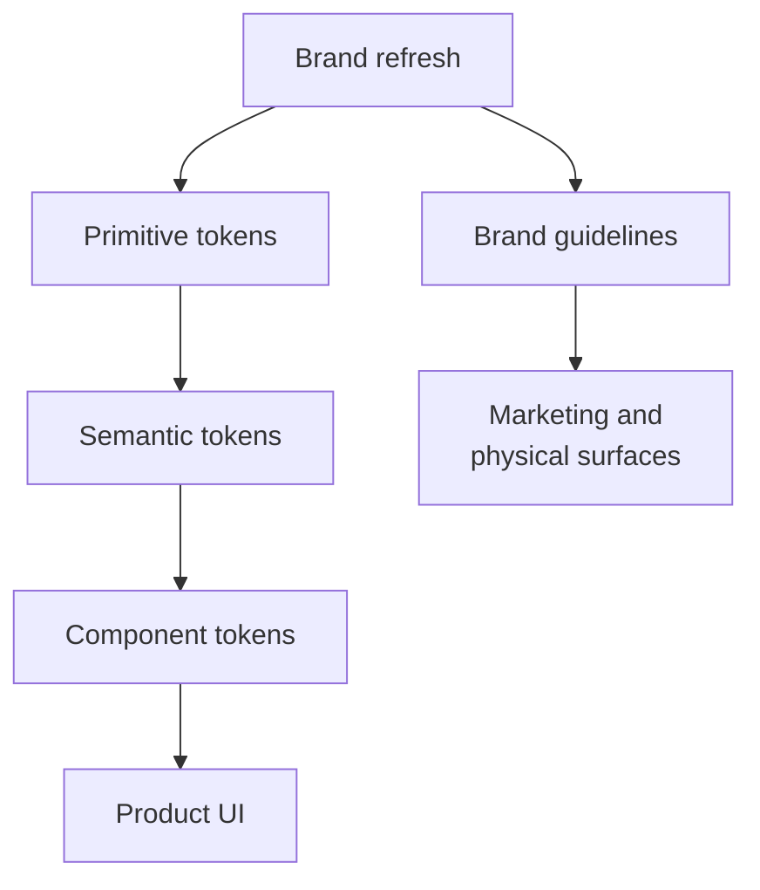

A design system implements brand identity. It doesn't own it. The design system covers product UI, built and maintained by designers and engineers. Brand guidelines cover something wider: visual identity across digital and physical surfaces, for marketers, agencies, and vendors who will never open a component library. The system should stay visually aligned with the brand without trying to be the thing that owns it.

:::tip[Key takeaways]
- **Separate product UI from campaign work.** Otherwise marketing routes around the system, or the system grows features it was never built for.
- **Let a brand refresh flow through tokens.** A refresh handled as a local fork splits that product from the system.
- **Keep brand values at the primitive tier.** Brand values hardcoded further down turn the next rebrand into a search.
:::

## The problem

Brand and marketing teams need to move fast on campaigns, ship one-off pages, and stay flexible enough to chase a moment. A governed, contribution-reviewed component library is the wrong tool for that. And a set of static brand templates is the wrong tool for a data table that has to handle twenty edge cases correctly. Treating one team's tooling as enough for the other's job produces a marketing team that goes around the design system entirely, and a design system that tries to grow print-shop features it was never built for.

## Choosing what the design system owns

Draw the line by what a surface is for. [userQ's comparison](https://userq.com/design-systems-vs-brand-guidelines-understanding-the-key-differences/) puts it this way: a surface whose job is persuasion and campaign flexibility belongs with brand guidelines, and one that needs consistent, reusable interaction patterns belongs in the design system.

### Product UI: the design system

Interactive, digital product surfaces that need reusable patterns and correct edge-case behavior. Governed by the system's contribution and release process.

### Marketing and physical surfaces: brand guidelines

Print, packaging, signage, campaign pages, and usually the marketing or brochure site. **DHL's** Brand Hub shows what this side looks like at scale: 10,000+ templates, an AI layout generator, and a custom typeface, built for global brand consistency across marketing and physical materials. It's brand tooling for marketers and vendors, not a component library for product teams, and the two were never meant to merge.

## Practices

### Let a brand refresh flow through the token tiers

**Wise's** 2023 brand refresh is the clearest real example. It didn't stay a marketing-only exercise. It drove a 2024 rebuild of the product system's token infrastructure (the "Editorial Design System") to carry the new identity through to product surfaces ([Ness Grixti's case study](https://nessgrixti.com/portfolio/wise-multi-brand/)). [Case Studies](/ds101/case-studies/) covers what went wrong when a related brand-theming change was handled as a local fork instead of a system-wide change.

### Keep brand values at the primitive tier

[Token architecture](/ds101/token-architecture/)'s three tiers (primitive → semantic → component) are where brand and product actually meet in code. A rebrand should mean updating the primitive-tier values that encode the brand's colors, type, and spacing in one place, with the semantic and component tiers picking up the change automatically. If brand values get hardcoded further down the stack, the next rebrand means hunting down every reference instead of changing one tier.

### Ship the rebrand behind an opt-in switch

Even a rebrand that only changes token values reaches every product at once, and each team still has to check it in its own screens. GOV.UK's guidance puts that check on the team: "You're responsible for making sure your service continues to work as expected after upgrading" ([GOV.UK Frontend](https://frontend.design-system.service.gov.uk/staying-up-to-date/)). Its 2025 brand refresh gave teams room to do that in three steps.

First, [v5.10.0](https://github.com/alphagov/govuk-frontend/releases/tag/v5.10.0) shipped the new logo, header, footer and assets behind a switch each team turned on itself: a template setting, a class on the `<html>` element, or a `rebrand` option on the header and footer. Each setup got its own instructions, including services that write their own HTML. Second, the release set one go-live date, asking teams to deploy "on 25 June 2025 or as soon after this date as possible," so people moving from the GOV.UK website into a service saw one brand. Third, [v6.0.0](https://github.com/alphagov/govuk-frontend/releases/tag/v6.0.0) made the new brand the default and removed the old one along with the switch.

That's the deprecate, migrate, remove sequence from [Release management](/ds101/release-management/), applied to a brand. The shared date matters most when many teams deploy on their own schedules, as GOV.UK's services do.

A single product can skip the shared date, but it may still want the switch. Lloyds' rebrand went into one banking app, and [Kishan Koriya](https://www.youtube.com/watch?v=ZHN0SkrzxdY), who manages its native design system, says the hard part was "not actually in rolling out the changes, but in the testing phase." So the team kept the current theme live for customers and tested the new one "silently via feature flags" (switches in the code that turn a change on for some users only), then deployed it to over 8,000 beta users before launch. The same theme switching later let them ship dark mode in a few months.

### List what the tokens don't reach

Tokens carry color, type and spacing. A rebrand also touches files that sit outside the package's styles. GOV.UK's v5.10.0 notes split the work in two. The package changed the CSS by itself, plus the logo and crown for teams using its templates. Each team had to do the rest by hand: serve the new assets folder, point the favicon, manifest and Open Graph image links at it, update the `theme-color` value, and paste in the new SVGs if they didn't use the templates.

Image assets can multiply out of sight. At Lloyds, [Koriya](https://www.youtube.com/watch?v=ZHN0SkrzxdY) found that a base set of 250 new icons and illustrations would have become over 2,000 files in code, one for each size, padding and trimming variant. Because the codebase stored assets as PDFs, one per color, that could have reached 20,000. His team wrapped each asset in a "canvas," a layer that applies sizing, padding and trimming by rule, so one file covers every case, and replaced the PDFs with SVGs.

Write that hand-done list into the [migration guide](https://www.designsystemtactics.com/tactics/migration-guides), split by setup, because no package upgrade will do it for a team. Before the release, check [token compliance](/ds101/adoption-metrics/). Teams that hardcode raw colors won't pick up the new palette, so they have more on their list than the guide assumes.

### Align brand and product on a recurring cadence

The fix isn't picking one team to own both. It's cross-functional alignment on a regular schedule, so brand identity and product implementation stay two things aimed at the same target, instead of one team's tool quietly standing in for the other's.

[Vishal Kapoor](https://www.youtube.com/watch?v=ZHN0SkrzxdY), who leads the design language team at Lloyds, describes the usual setup as a one-way stream: brand works in isolation and hands digital a PDF, "pretty much just sort of throwing it over the fence." The digital section of Lloyds' own brand PDF showed only the website homepage and the app's splash screen, which left the design system team to fill the gaps while systemizing at the same time. Lloyds added design language as a layer between the two. It defines how the brand looks in the product, and the system team turns those decisions into rules and components. During the rebrand, Kapoor's team worked with the brand agency and the internal brand team in a shared Figma file from the start, with weekly sessions, instead of waiting for finished guidelines.

A separate team is a large-organization answer: Lloyds has around 450 designers. The part that doesn't depend on headcount is timing. Someone from the system joins brand's working sessions while the identity is still being shaped, not after it's signed off.

## Common mistakes

- **Assuming a mature product design system automatically covers marketing's needs, or the reverse.** A large, polished brand platform isn't a design system, and a design system isn't a brand platform. Each side inherits the other's constraints when one tries to stand in for the other.
