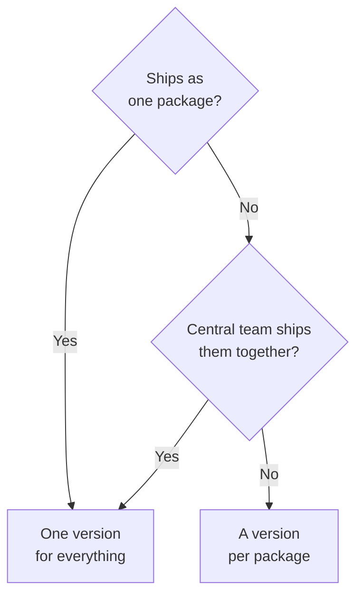

A coded library release is the path from a merged pull request to a version teams can install. Each step should pass on what the change breaks, so nobody has to work it out again on release day. Use only as much tooling as the library's size needs.

:::tip[Key takeaways]
- **Write the version bump with the change.** Otherwise someone guesses the impact at release time, long after the author has moved on.
- **Ship previews under their own tag.** An untagged preview becomes the version every team installs next.
- **Publish from CI, not a laptop.** A hand-run publish can't be traced back to the code it was built from.
:::

## The problem

Without a set release process, a release depends on whoever runs it remembering everything. Curtis's [survey of release cadence](https://medium.com/eightshapes-llc/design-system-release-cadence-2e3e6694ba21) found that at Salesforce Lightning and Morningstar an assigned developer spent two to four hours on each release. In a library made of many packages, the work multiplies. Jony Cheung of **Atlassian's** Atlaskit, in Curtis's [post on dependencies](https://nathanacurtis.substack.com/p/dealing-with-dependencies-inside-design-systems-aa6ce2cf7bc3): "If we upgrade and break a component, we have to go through and fix all the dependent components." [Release management](/ds101/release-management/) owns what a release has to tell adopters. This page covers how a coded library gets there.

## Choosing how packages share a version

If your library ships as one package, there's nothing to choose: it has one version. The choice appears once tokens, icons, and components ship as separate packages. [Supernova's survey of real systems](https://www.supernova.io/blog/8-examples-of-versioning-in-leading-design-systems) finds both options in production and doesn't rank them. The right one depends on how centralized the system team and its adopters already are.

<div class="mermaid-wrap">



</div>

### One version for everything

Everything ships under one number ("we're on 4.2"), and releases are synchronized. This fits a centralized team shipping tokens, components, and guidelines together. The cost: a fix to one component forces every consumer into an upgrade. In [Changesets](https://github.com/changesets/changesets/blob/main/docs/guide/fixed-packages.md), these are "fixed" packages: "all packages will always have the same version," and they're published together even when some have no changes.

### A version per package

Each package ships its own fixes on its own schedule, so an unrelated fix doesn't force anyone to upgrade. The cost: adopters track many numbers instead of one, and the team has to manage how packages depend on each other (see [Release dependents deliberately](#release-dependents-deliberately)). Changesets also has "linked" packages, a middle option: they share a version number, but "Linked packages will only be bumped when there is a changeset for them." Its config docs warn that linked "does not do what some other tools do," so check which one you mean.

## Practices

### Write the bump with the change

The person making a change knows best what it breaks, so record that in the same pull request, not at release time. In [Changesets](https://github.com/changesets/changesets/blob/main/docs/guide/writing-changesets.md), each pull request adds a small markdown file naming the packages, the bump type, and a summary. Its guide says to state what changed, why, and how adopters should update, and "highly" recommends migration steps for a major. The shape, from the guide:

```md
---
"@acme/button": major
---

Rename `kind` to `variant`.
Replace `kind="primary"`
with `variant="primary"`.
```

At release, `changeset version` turns the files into version bumps and changelog entries, combining several changes to one package into a single bump at the highest level. In CI (continuous integration: automated jobs that run on every pull request), an action can open that as a version pull request and publish when it merges. The rule matters more than the tool. A single-package library with one or two maintainers gets the same benefit from a hand-written [Keep a Changelog](https://keepachangelog.com) entry in each pull request, and adds tooling when entries start getting missed.

### Release dependents deliberately

When many packages use one package, its breaking change forces work on all of them. Atlaskit's icon package had 62 dependents when Curtis wrote about it in 2018. Its release tool listed every dependent and asked for a bump level for each one, and a major in icon didn't force a major in button. The **Financial Times'** Origami failed the build when two versions of one module were required. Packages in separate repositories release in order: at **Shopify**, tokens first, then the React library and UI kit, then the doc site.

[Changesets](https://github.com/changesets/changesets/blob/main/docs/guide/technical-decisions.md) makes the default explicit: when a change would take a dependent out of its version range, the dependent gets a patch, because "all updating of dependencies is done as a patch bump." Its [config](https://github.com/changesets/changesets/blob/main/docs/guide/config.md) setting `updateInternalDependencies` decides whether dependents pick up every patch or only minors. This practice only applies once the library is several packages. Atlaskit's 62 dependents show the large end of the scale. [System inventory](/ds101/system-inventory/) tags the components with many dependents, and [Dependency observability](/ds101/dependency-observability/) covers tracing them.

### Publish from CI with provenance

A package published from someone's laptop gives adopters no way to check what was built from which code. npm's [trusted publishing](https://docs.npmjs.com/trusted-publishers) lets a CI workflow publish without a stored token: npm, the public package registry, is told which repository and workflow file may publish, and the workflow exchanges a short-lived identity token for each publish. It works on GitHub-hosted runners, GitLab.com shared runners, and CircleCI cloud, not on self-hosted runners. From a public GitHub or GitLab repository it also adds a [provenance statement](https://docs.npmjs.com/generating-provenance-statements), a signed link from the published package to its source and build. npm is clear about the limit: provenance "does not guarantee the package has no malicious code." It proves where a package came from, not that the package is safe.

Unlike most practices here, this one costs about the same at any size: a registry setting and a few lines of workflow. Changesets' [automation guide](https://github.com/changesets/changesets/blob/main/docs/guide/automating.md) recommends it and calls publishing with a stored npm token "no longer recommended." It notes one gap: npm's newer staged publishing doesn't work with Changesets yet.

### Ship previews under their own tag

A preview, whether a prerelease or a snapshot build, lets adopters try a change before everyone gets it. A prerelease is the version of a major meant for early testers. [npm](https://docs.npmjs.com/cli/v12/commands/npm-dist-tag) explains why it needs its own tag: "Publishing a package sets the `latest` tag to the published version unless the `--tag` option is used," and a plain `npm install` gets `latest`. So a preview has to go out under another tag, such as `next` or `beta`. "Other than `latest`, no tag has any special significance to npm itself," so the names are yours to define and publish.

[Changesets' prerelease mode](https://github.com/changesets/changesets/blob/main/docs/guide/prereleases.md) publishes versions like `1.0.0-beta.0` under the tag you pick. Its own warning: "Prereleases are very complicated! Using them requires a thorough understanding of all parts of npm publishes." That warning is a reason to use prereleases only when teams outside the system team need to test a major before it ships. [Snapshot releases](https://github.com/changesets/changesets/blob/main/docs/guide/snapshot-releases.md), throwaway builds for testing one pull request, are lighter, but carry the same risk: without a tag, "installing your package will default to the snapshot version."

### Put the warning where code is written

A deprecation notice in the changelog reaches people who read the changelog. A warning in the editor reaches everyone writing code against the library, and today that includes coding agents. [zeroheight's](https://help.zeroheight.com/hc/en-us/articles/36474257606555-Deprecating-in-design-systems-When-it-s-time-to-say-goodbye) step for any team: have build tooling warn on continued use where possible, and fail the build in a mature system.

Atlassian shows what this looks like for a very large system. Its [ESLint plugin](https://atlassian.design/get-started/develop/atlassians) shows "deprecation notices" in the editor. Its [llms.txt](https://atlassian.design/llms.txt), the plain-text index it publishes for language models, marks the old primitives package "legacy, deprecated," names the replacement, and lists codemods (scripts that rewrite old usage automatically). Its [agent skill](https://atlassian.design/get-started/with-ai), private to Atlassian for now, covers "Components, tokens, icons, accessibility, and migrations," and a public MCP server (a standard way for agents to query a tool) gives any agent its tokens, icons, components, and accessibility tooling. Its pages don't say how well agents follow any of this. That set is built for a system used by many product teams in one company. A small library gets most of the benefit from a deprecation marker the editor shows, plus a line in whatever context file its agents read. [Documentation for agents](/ds101/documentation-for-agents/) covers writing for that reader.

### Keep docs for every supported version

A team that can't upgrade yet still needs docs that match the version it runs. Curtis's [versioning post](https://medium.com/eightshapes-llc/versioning-design-systems-48cceb5ace4d) describes Morningstar keeping each release's docs under its own address, as in `/v1.13.0/`, with links that stay inside that version. This only pays off while you support more than one major at a time. With a short deprecation window and a migration page, the current docs plus the [migration page](/ds101/release-management/#put-breaking-changes-on-one-migration-page) are enough.

## Common mistakes

- **Publishing a preview without a tag.** npm gives a plain install whatever is tagged `latest`, so an untagged snapshot or prerelease becomes everyone's next install ([Changesets](https://github.com/changesets/changesets/blob/main/docs/guide/snapshot-releases.md)).
- **Choosing "linked" when you meant "fixed."** Linked packages share a number but only bump when they change. If every package must always carry the same version, that's [fixed](https://github.com/changesets/changesets/blob/main/docs/guide/fixed-packages.md).
- **Adopting monorepo tooling for one package.** A monorepo is one repository holding several packages. Fixed and linked groups, dependent bumps, and prerelease mode solve problems a single package doesn't have, and Changesets itself calls prereleases "very complicated." Add the tooling when the library splits into packages.
