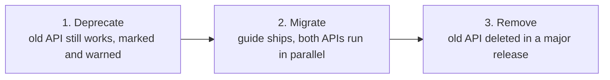

A version number, a changelog entry, and a migration guide are three views of the same event: they tell consuming teams what upgrading will cost them. When all three tell the truth, teams keep upgrading. When they don't, teams stop.

:::tip[Key takeaways]
- **Use SemVer to signal impact.** Without it, teams can't tell a safe upgrade from a breaking one until they read the diff.
- **Deprecate before you remove.** A removal with no warning turns an upgrade into an incident.
- **Put breaking changes on one migration page.** Otherwise every consuming team works out the same fix on its own.
:::

## The problem

Without a reliable signal for impact, teams do one of two things. They upgrade blindly and get broken by changes they had no warning about. Or they stop upgrading, because every past upgrade cost them unplanned work. Both have the same cause: the version number, changelog, and migration path didn't tell the truth about what the change would cost.

## Practices

### Make the version number tell the truth

**Use SemVer as the impact signal.** Semantic Versioning (SemVer) tells a consuming team the *impact* of a change before anyone reads the diff. Major means something will break. Minor means something new is safe to ignore. Patch means nothing about your code needs to change. [Nathan Curtis](https://medium.com/eightshapes-llc/versioning-design-systems-48cceb5ace4d) notes that nearly every design system he's worked with uses SemVer for this reason: it's cheap to adopt, and it's the one signal a team can act on without reading release notes first. He adds that the first major is a promise: "`1.0.0` should be a clear commitment to stable and predictable change." **Atlassian** publishes what each [release phase](https://atlassian.design/release-phases) promises. Early Access components sit at `0.x`: "There may be breaking changes in minor releases at versions `0.x`." Beta components are at 1.0 or later and break only in major releases, which "should be infrequent." General Availability is fully stable.

**Decide what counts as a visual breaking change.** SemVer was written for code APIs, and most teams never say what a style change is worth. Curtis's [post on visual breaking change](https://nathanacurtis.substack.com/p/visual-breaking-change-in-design-systems-1e9109fac9c4) asks: "Can adopters upgrade to a minor release confident that their UI won't break due to a system's visual changes?" He proposes rules for at least color, typography, and space. A new primary button fill is safe. A text color that can sit on an adopter's background, or a background under an adopter's text, can break contrast. A heavier weight or wider letter-spacing can make tab labels wrap or crop. Padding inside a component is safe, but a margin or size change outside its boundary moves the adopter's layout. He suggests agreeing the team's tolerance for risk in one working session and writing the result down. In 2018, **Morningstar** already documented what counts as major, minor, and patch on its versioning page.

**Version token changes on their own.** Tokens sit underneath every component, so a token change reaches more components than any other kind of change. A renamed or re-scoped color token can quietly break dozens of components that never touched their own code. The [Design Tokens Substack](https://designtokens.substack.com/p/how-to-manage-breaking-changes-in) recommends treating token changes as release events in their own right, with their own major/minor/patch reasoning, instead of folding them into a component release where the impact is easy to miss. Curtis gives the same advice: ship tokens as a separate package so they can release without a component release.

**Release dependents deliberately.** When many components use one component, its breaking change forces work on all of them. Atlaskit's icon package had 62 dependents when Curtis wrote [about dependencies](https://nathanacurtis.substack.com/p/dealing-with-dependencies-inside-design-systems-aa6ce2cf7bc3) in 2018. Jony Cheung of Atlaskit: "If we upgrade and break a component, we have to go through and fix all the dependent components." Atlaskit's release tool listed every dependent and asked for a bump level for each one. A major in icon didn't force a major in button. The **Financial Times'** Origami fails the build when two versions of one module are required. Packages in separate repositories release in order: at **Shopify**, tokens first, then the React library and UI kit, then the doc site. [Changesets](https://github.com/changesets/changesets/blob/main/docs/guide/technical-decisions.md), a current tool for monorepos, makes the default explicit: when a change would take a dependent out of its version range, the dependent gets a patch, because "all updating of dependencies is done as a patch bump." [System inventory](/ds101/system-inventory/) tags the components with many dependents, and [Dependency observability](/ds101/dependency-observability/) covers tracing them.

**Write the bump with the change.** The person making a change knows best what it breaks, so record that in the same pull request, not at release time. In [Changesets](https://github.com/changesets/changesets/blob/main/docs/guide/writing-changesets.md), each pull request adds a small markdown file naming the packages, the bump type, and a summary. Its guide says to state what changed, why, and how consumers should update, and "highly" recommends migration steps for a major. The shape, from the guide:

```md
---
"@acme/button": major
---

Rename `kind` to `variant`.
Replace `kind="primary"`
with `variant="primary"`.
```

At release, `changeset version` turns the files into version bumps and changelog entries, combining several changes to one package into a single bump at the highest level. A CI action can open that as a version pull request and publish when it merges. The [automation guide](https://github.com/changesets/changesets/blob/main/docs/guide/automating.md) recommends npm trusted publishing from CI, and calls publishing with a stored npm token "no longer recommended."

### Give adopters time to move

**Deprecate before you remove.** [zeroheight](https://zeroheight.com/blog/handling-breaking-changes-in-a-design-system-without-causing-chaos/) frames a breaking change as a lifecycle with three phases. Skipping straight to removal is what turns an upgrade into an incident.

<div class="mermaid-wrap">



</div>

The mechanics in [zeroheight's deprecation guide](https://help.zeroheight.com/hc/en-us/articles/36474257606555-Deprecating-in-design-systems-When-it-s-time-to-say-goodbye): put a visible marker like `[DEPRECATED]` in the item's description field. Where possible, have build tooling detect continued usage and warn, or in a mature system, fail the build. The specific marker doesn't matter. What matters is that the deprecation is visible *where the item is used*, not just announced once in a changelog. Atlassian makes it a promise: "No General Availability feature will be removed from the system without a clearly announced deprecation period." An "Intent to Deprecate" stage comes before Deprecated. This is the release-side view of the removal lane in [Component lifecycle](/ds101/component-lifecycle/), where Inayaili de León Persson asks for "deprecation shipped with advance notice, not a surprise."

**Size the deprecation window to your adopters.** How long the old version stays depends on how fast adopters can move. Curtis's [versioning post](https://medium.com/eightshapes-llc/versioning-design-systems-48cceb5ace4d) gives **Salesforce** 18 months and Origami three to six. Morningstar shipped a new and a deprecated Notification side by side for six months, until 2.0.0 removed the old one. Origami's Rowan Manning describes what deprecation means there: "At no point does the deprecated feature become unavailable. Instead, our commitment to maintain it stops." Keep each version's docs at its own address too. Morningstar publishes them under the version, as in `/v1.13.0/`, so a team that can't upgrade yet still reads the right docs.

**Put the warning where code is written.** Today that includes coding agents, which read a deprecation only if it's somewhere they look. Atlassian puts it in several places. Its [ESLint plugin](https://atlassian.design/get-started/develop/atlassians) shows "deprecation notices" in the editor. Its [llms.txt](https://atlassian.design/llms.txt), the plain-text index it publishes for language models, marks the old primitives package "legacy, deprecated" and names the replacement, and it lists codemods (scripts that rewrite old usage automatically). Its [agent skill](https://atlassian.design/get-started/with-ai), private to Atlassian for now, covers "Components, tokens, icons, accessibility, and migrations." A public MCP server gives any agent its tokens, icons, components, and accessibility tooling. Its pages don't say how well agents follow any of this. [Documentation for agents](/ds101/documentation-for-agents/) covers writing for that reader.

**Put breaking changes on one migration page.** **Carbon Design System's** [migration guide](https://v10.carbondesignsystem.com/help/migration-guide/design/) is the reference example. Instead of scattering breaking changes across changelog entries, every breaking change in a release goes on one page, next to what to do instead. A guide that says what changed, but not what a team should now do, has done half the job.

**Ship previews under their own tag.** A prerelease lets early adopters try a major before everyone gets it. On npm, a plain install gets whatever carries the `latest` tag, so a preview has to be published under another tag, such as `next` or `beta`. [Changesets' prerelease mode](https://github.com/changesets/changesets/blob/main/docs/guide/prereleases.md) does this, publishing versions like `1.0.0-beta.0` under the tag you pick. Its own warning: "Prereleases are very complicated! Using them requires a thorough understanding of all parts of npm publishes." A brand-new package in prerelease mode still gets the `latest` tag too, because npm requires one. [Snapshot releases](https://github.com/changesets/changesets/blob/main/docs/guide/snapshot-releases.md), throwaway builds for testing a pull request, carry the same risk: without a tag, "installing your package will default to the snapshot version."

### Tell teams what changed

**Sort the changelog into standard categories.** The [Keep a Changelog](https://keepachangelog.com) categories are Added, Changed, Deprecated, Removed, Fixed, and Security. They give every entry a home. A team checking "does this affect me?" should be able to answer from the category headers alone. [UXPin's changelog guide](https://www.uxpin.com/studio/blog/how-to-create-a-design-system-changelog/) adds: put the version number and date on every entry.

**Keep the changelog public and current.** A visible changelog, even a shared Notion page, builds trust. [UXPin](https://www.uxpin.com/studio/blog/how-to-create-a-design-system-changelog/) puts it this way: "when people can see what changed and why, they're more likely to update their implementations and less likely to fork the system out of frustration." A stale changelog reads to consumers like an unmaintained system, whether or not the system is healthy. [Decision governance](/ds101/decision-governance/) names the same risk.

**Push every release to consuming teams.** A changelog that teams have to remember to check gets missed by the teams who most need the warning. Post every release automatically, not just major ones, to Slack or email. That's what turns a written record into something teams act on before it breaks them. A Figma library needs more than a post, because publishing doesn't change anyone's files: [Figma library releases](/ds101/figma-library-releases/) covers that side.

**Decide whether Figma and code ship together.** Code, docs, and the Figma library don't have to release on the same day, but the team has to choose. Curtis's [2018 survey of release cadence](https://medium.com/eightshapes-llc/design-system-release-cadence-2e3e6694ba21) found three mixes. Some teams couple code and docs and update the design toolkit less often. Some release the toolkit and design docs every two weeks while engineering ships code on its own schedule. Others ship code every two weeks and let anyone update docs at any time. Teams that release code continuously, such as **Atlassian's** Atlaskit and the **Financial Times'** Origami, pay for it: "the design toolkit and documentation lag or drift from code's interminable forward momentum." Consumers have limits too. The post quotes Nate Baldwin of Adobe Spectrum: "We have clients building against specific timelines. They can't — and don't want to — constantly pull down UI updates." Whatever the mix, write it down, so designers know whether a Figma update means the code is ready. [Figma library releases](/ds101/figma-library-releases/) covers how the Figma side ships. [Operating cadence](/ds101/operating-cadence/) covers the sprint rhythm itself.

## Choosing a versioning strategy

[Supernova's survey of real systems](https://www.supernova.io/blog/8-examples-of-versioning-in-leading-design-systems) finds both strategies below in production. Neither is more correct. The right one depends on how centralized the system team and its consumers already are.

### System-wide versioning

Everything ships under one number ("we're on 4.2"), and releases are synchronized. This fits a centralized team shipping tokens, components, and guidelines together. The cost: a fix to one component forces every consumer into an upgrade.

### Component-level versioning

Each component ships its own fixes on its own schedule, so an unrelated fix doesn't force anyone to upgrade. The cost: consumers track many numbers instead of one.

## Common mistakes

- **Treating the migration guide as optional polish.** A major version with no guide makes every consuming team reverse-engineer the same diff on its own. Writing the guide once costs far less than dozens of teams doing that work in parallel. If a release is big enough for a major version, it's big enough for the guide.
- **Calling a color change a patch.** A darker card background or a new link blue can break contrast with text the adopter put on it. [Curtis](https://nathanacurtis.substack.com/p/visual-breaking-change-in-design-systems-1e9109fac9c4) shows both cases. Without written rules for visual change, a "safe" minor breaks screens.
- **Publishing a preview without a tag.** npm hands a plain install whatever is tagged `latest`, so an untagged snapshot or prerelease becomes everyone's next install ([Changesets](https://github.com/changesets/changesets/blob/main/docs/guide/snapshot-releases.md)).
