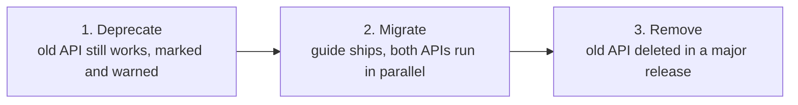

A version number, a changelog entry, and a [migration guide](https://www.designsystemtactics.com/tactics/migration-guides) are three views of the same event: they tell consuming teams what upgrading will cost them. When all three tell the truth, teams keep upgrading. When they don't, teams stop.

:::tip[Key takeaways]
- **Use SemVer to signal impact.** Without it, teams can't tell a safe upgrade from a breaking one until they read the diff.
- **Deprecate before you remove.** A removal with no warning turns an upgrade into an incident.
- **Put breaking changes on one migration page.** Otherwise every consuming team works out the same fix on its own.
:::

## The problem

Without a reliable signal for impact, teams do one of two things. They upgrade blindly and get broken by changes they had no warning about. Or they stop upgrading, because every past upgrade cost them unplanned work. Both have the same cause: the version number, changelog, and migration path didn't tell the truth about what the change would cost.

## Practices

### Use SemVer as the impact signal

Semantic Versioning (SemVer) tells a consuming team the *impact* of a change before anyone reads the diff. Major means something will break. Minor means something new is safe to ignore. Patch means nothing about your code needs to change. [Nathan Curtis](https://medium.com/eightshapes-llc/versioning-design-systems-48cceb5ace4d) notes that nearly every design system he's worked with uses SemVer for this reason: it's cheap to adopt, and it's the one signal a team can act on without reading release notes first. He adds that the first major is a promise: "`1.0.0` should be a clear commitment to stable and predictable change."

Large systems extend that promise per component. **Atlassian** publishes what each [release phase](https://atlassian.design/release-phases) promises. Early Access components sit at `0.x`: "There may be breaking changes in minor releases at versions `0.x`." Beta components are at 1.0 or later and break only in major releases, which "should be infrequent." General Availability is fully stable. Named phases pay off when hundreds of teams need to know which components are safe to build on. A small library can say the same thing with Curtis's single line between `0.x` and `1.0.0`.

### Decide what counts as a breaking change

SemVer was written for code APIs, and most teams never say what a style change is worth. Curtis's [post on visual breaking change](https://nathanacurtis.substack.com/p/visual-breaking-change-in-design-systems-1e9109fac9c4) asks: "Can adopters upgrade to a minor release confident that their UI won't break due to a system's visual changes?" He proposes rules for at least color, typography, and space. A new primary button fill is safe. A text color that can sit on an adopter's background, or a background under an adopter's text, can break contrast. A heavier weight or wider letter-spacing can make tab labels wrap or crop. Padding inside a component is safe, but a margin or size change outside its boundary moves the adopter's layout. He suggests agreeing the team's tolerance for risk in one working session and writing the result down. This applies at any size: a three-person team's adopters get broken screens to a contrast change just as a large system's do. The [criteria below](#criteria-for-a-major-release) collect the rules.

### Version token changes on their own

Tokens sit underneath every component, so a token change reaches more components than any other kind of change. A renamed color token, or one pointed at a different value, can quietly break dozens of components that never touched their own code. The [Design Tokens Substack](https://designtokens.substack.com/p/how-to-manage-breaking-changes-in) recommends treating token changes as release events in their own right, with their own major/minor/patch reasoning, instead of folding them into a component release where the impact is easy to miss. Curtis goes further and ships tokens as a separate package, so they can release without a component release. That split matters once tokens have consumers of their own, such as other platforms or a Figma library. If tokens and components only ever ship together, separate changelog entries and bump reasoning get most of the benefit.

### Deprecate before you remove

[zeroheight](https://zeroheight.com/blog/handling-breaking-changes-in-a-design-system-without-causing-chaos/) frames a breaking change as a lifecycle with three phases. Skipping straight to removal is what turns an upgrade into an incident.

The mechanics in [zeroheight's deprecation guide](https://help.zeroheight.com/hc/en-us/articles/36474257606555-Deprecating-in-design-systems-When-it-s-time-to-say-goodbye): put a visible marker like `[DEPRECATED]` in the item's description field. Where possible, have build tooling detect continued usage and warn, or in a mature system, fail the build. The specific marker doesn't matter. What matters is that the deprecation is visible *where the item is used*, not just announced once in a changelog. Atlassian makes it a promise: "No General Availability feature will be removed from the system without a clearly announced deprecation period."

How long the old version stays depends on how fast adopters can move. Curtis's [versioning post](https://medium.com/eightshapes-llc/versioning-design-systems-48cceb5ace4d) gives **Salesforce** 18 months and the **Financial Times'** Origami three to six. Morningstar shipped a new and a deprecated Notification side by side for six months, until 2.0.0 removed the old one. Origami's Rowan Manning describes what deprecation means there: "At no point does the deprecated feature become unavailable. Instead, our commitment to maintain it stops." Size the window to the slowest adopter you still support, not to the largest system you've read about. This is the release-side view of the removal lane in [Component lifecycle](/ds101/component-lifecycle/), where Inayaili de León Persson asks for "deprecation shipped with advance notice, not a surprise."

### Put breaking changes on one migration page

**Carbon Design System's** [migration guide](https://v10.carbondesignsystem.com/help/migration-guide/design/) is the reference example. Instead of scattering breaking changes across changelog entries, every breaking change in a release goes on one page, next to what to do instead. A guide that says what changed, but not what a team should now do, has done half the job.

### Sort and publish the changelog

The [Keep a Changelog](https://keepachangelog.com) categories are Added, Changed, Deprecated, Removed, Fixed, and Security. They give every entry a home. A team checking "does this affect me?" should be able to answer from the category headers alone. [UXPin's changelog guide](https://www.uxpin.com/studio/blog/how-to-create-a-design-system-changelog/) adds: put the version number and date on every entry, and keep the changelog where people can see it, even if that's a shared Notion page: "when people can see what changed and why, they're more likely to update their implementations and less likely to fork the system out of frustration." A stale changelog reads to consumers like an unmaintained system, whether or not the system is healthy. [Decision governance](/ds101/decision-governance/) names the same risk.

### Push every release to consuming teams

A changelog that teams have to remember to check gets missed by the teams who most need the warning. Post every release automatically, not just major ones, to Slack or email. That's what turns a written record into something teams act on before it breaks them. A Figma library needs more than a post, because publishing doesn't change anyone's files: [Figma library releases](/ds101/figma-library-releases/) covers that side.

### Decide whether Figma and code ship together

Code, docs, and the Figma library don't have to release on the same day, but the team has to choose. Curtis's [2018 survey of release cadence](https://medium.com/eightshapes-llc/design-system-release-cadence-2e3e6694ba21) found three mixes. Some teams couple code and docs and update the design toolkit less often. Some release the toolkit and design docs every two weeks while engineering ships code on its own schedule. Others ship code every two weeks and let anyone update docs at any time. Teams that release code continuously, such as **Atlassian's** Atlaskit and Origami, pay for it: "the design toolkit and documentation lag or drift from code's interminable forward momentum." Consumers have limits too. The post quotes Nate Baldwin of Adobe Spectrum: "We have clients building against specific timelines. They can't — and don't want to — constantly pull down UI updates." Whatever the mix, write it down, so designers know whether a Figma update means the code is ready. [Code library releases](/ds101/code-library-releases/) and [Figma library releases](/ds101/figma-library-releases/) cover how each side ships. [Operating cadence](/ds101/operating-cadence/) covers the sprint rhythm itself.

### Criteria for a major release

Ask these in order. One "yes" makes the change a major in code, or a labelled breaking change in the Figma library. Deprecate first where you can.

1. Does any adopter have to change code to keep working? That's SemVer's own definition of major.
2. Is a prop, export, or token renamed, removed, or pointed at a different value? A token name is a contract ([Token architecture](/ds101/token-architecture/)).
3. Does the package add a peer dependency (a package the adopter must install alongside yours, such as React)? [Changesets](https://github.com/changesets/changesets/blob/main/docs/guide/technical-decisions.md) releases that as a major, and says the decision is open for discussion.
4. Can a text or background color change contrast with content the adopter supplies? ([Curtis](https://nathanacurtis.substack.com/p/visual-breaking-change-in-design-systems-1e9109fac9c4))
5. Can a font weight, letter-spacing, or size change make text wrap or crop?
6. Does spacing or size change outside the component's own boundary?
7. Would a designer have to take action after accepting the Figma update? That's [Pajamas's](https://design.gitlab.com/get-started/uik-breaking-changes) definition of a breaking change in a Figma library.

## Common mistakes

- **Treating the migration guide as optional polish.** A major version with no guide makes every consuming team reverse-engineer the same diff on its own. Writing the guide once costs far less than dozens of teams doing that work in parallel. If a release is big enough for a major version, it's big enough for the guide.
- **Calling a color change a patch.** A darker card background or a new link blue can break contrast with text the adopter put on it. [Curtis](https://nathanacurtis.substack.com/p/visual-breaking-change-in-design-systems-1e9109fac9c4) shows both cases. Without written rules for visual change, a "safe" minor breaks screens.
- **Copying a large system's process whole.** Atlassian's release phases, Salesforce's 18-month window, and a separate tokens package answer problems of hundreds of consuming teams. A small library pays their cost without having the problem. Start with SemVer, a written breaking-change rule, and a changelog, and add the rest when a real adopter needs it.
