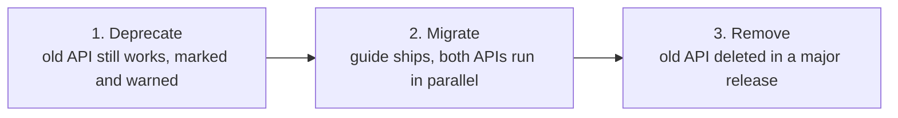

A version number, a changelog entry, and a migration guide are three views of the same event: they tell consuming teams what upgrading will cost them. When all three tell the truth, teams keep upgrading. When they don't, teams stop.

:::tip[Key takeaways]
- **Use SemVer to signal impact.** Without it, teams can't tell a safe upgrade from a breaking one until they read the diff.
- **Deprecate before you remove.** A removal with no warning turns an upgrade into an incident.
- **Put breaking changes on one migration page.** Otherwise every consuming team works out the same fix on its own.
:::

## The problem

Without a reliable signal for impact, teams do one of two things. They upgrade blindly and get broken by changes they had no warning about. Or they stop upgrading, because every past upgrade cost them unplanned work. Both have the same cause: the version number, changelog, and migration path didn't tell the truth about what the change would cost.

## Practices

### Use SemVer as the impact signal

Semantic Versioning (SemVer) tells a consuming team the *impact* of a change before anyone reads the diff. Major means something will break. Minor means something new is safe to ignore. Patch means nothing about your code needs to change. [Nathan Curtis](https://medium.com/eightshapes-llc/versioning-design-systems-48cceb5ace4d) notes that nearly every design system he's worked with uses SemVer for this reason: it's cheap to adopt, and it's the one signal a team can act on without reading release notes first.

### Version token changes on their own

Tokens sit underneath every component, so a token change reaches more components than any other kind of change. A renamed or re-scoped color token can quietly break dozens of components that never touched their own code. The [Design Tokens Substack](https://designtokens.substack.com/p/how-to-manage-breaking-changes-in) recommends treating token changes as release events in their own right, with their own major/minor/patch reasoning, instead of folding them into a component release where the impact is easy to miss.

### Deprecate before you remove

[zeroheight](https://zeroheight.com/blog/handling-breaking-changes-in-a-design-system-without-causing-chaos/) frames a breaking change as a lifecycle with three phases. Skipping straight to removal is what turns an upgrade into an incident.

The mechanics in [zeroheight's deprecation guide](https://help.zeroheight.com/hc/en-us/articles/36474257606555-Deprecating-in-design-systems-When-it-s-time-to-say-goodbye): put a visible marker like `[DEPRECATED]` in the item's description field. Where possible, have build tooling detect continued usage and warn, or in a mature system, fail the build. The specific marker doesn't matter. What matters is that the deprecation is visible *where the item is used*, not just announced once in a changelog.

**GitLab's** Pajamas UI kit applies the same rule to its Figma library. A deprecated component or style ["should remain available for at least one milestone"](https://design.gitlab.com/get-started/uik-breaking-changes) (one monthly release) before it's removed. Its name and description field get a `(⚠ DEPRECATED)` prefix and a link to the replacement, so designers see the warning on the instance they're already using.

This is the release-side view of the removal lane in [Component lifecycle](/ds101/component-lifecycle/), where Inayaili de León Persson asks for "deprecation shipped with advance notice, not a surprise."

### Put breaking changes on one migration page

**Carbon Design System's** [migration guide](https://v10.carbondesignsystem.com/help/migration-guide/design/) is the reference example. Instead of scattering breaking changes across changelog entries, every breaking change in a release goes on one page, next to what to do instead. A guide that says what changed, but not what a team should now do, has done half the job.

### Sort the changelog into standard categories

The [Keep a Changelog](https://keepachangelog.com) categories are Added, Changed, Deprecated, Removed, Fixed, and Security. They give every entry a home. A team checking "does this affect me?" should be able to answer from the category headers alone. [UXPin's changelog guide](https://www.uxpin.com/studio/blog/how-to-create-a-design-system-changelog/) adds: put the version number and date on every entry.

The same idea works for a Figma library. [Pajamas's release process](https://design.gitlab.com/get-started/uik-release-process) sorts its UI kit notes into Additions, Enhancements, Changes, and Fixes, with deprecations listed under Changes, including ones coming in the next release. Its rule for wording: "Use the simple present tense with an implied subject when adding to the release notes," as in "Adds itemName." Its [published notes](https://design.gitlab.com/get-started/uik-release-notes) also label each breaking entry with an impact level, as in "Breaking (medium): Updates focus ring utility to use border radius design tokens." A designer can then tell from the label alone how much checking the update needs.

### Keep the changelog public and current

A visible changelog, even a shared Notion page, builds trust. [UXPin](https://www.uxpin.com/studio/blog/how-to-create-a-design-system-changelog/) puts it this way: "when people can see what changed and why, they're more likely to update their implementations and less likely to fork the system out of frustration." A stale changelog reads to consumers like an unmaintained system, whether or not the system is healthy. [Decision governance](/ds101/decision-governance/) names the same risk.

### Push every release to consuming teams

A changelog that teams have to remember to check gets missed by the teams who most need the warning. Post every release automatically, not just major ones, to Slack or email. That's what turns a written record into something teams act on before it breaks them.

The push matters even more for a Figma library, because publishing doesn't change anyone's files. [Figma](https://help.figma.com/hc/en-us/articles/360039234193) shows a blue badge on the Libraries icon in each file that uses the library. A designer then applies changes asset by asset with Update, or all at once with Update all, after comparing old and new side by side or as an overlay. Until someone with edit access does that, the file keeps the old version. Each publish also asks for a description, ["a summary of any decisions or changes"](https://help.figma.com/hc/en-us/articles/360025508373), which Figma shows while designers accept the update and in version history. That's the release note designers actually see, so write the reason there and not only in the changelog. Pajamas lists the changes as a dashed list in that field.

### Review on a branch, publish from main

A Figma branch is a copy of the library file where changes can be made and reviewed without editing the original. [Figma's branching guide](https://help.figma.com/hc/en-us/articles/360063144053) is explicit about the order: "You can only publish to a library from the main file," so a branch has to be merged first. Its [best-practice page](https://www.figma.com/best-practices/branching-in-figma/) lets people without edit access to the library propose changes on a branch, "much like a pull request in code." Reviewers can approve, approve and merge, or ask for more changes. [Curtis](https://nathanacurtis.substack.com/p/figma-shared-libraries-d2dfbf9d1b8d) saw this settle into a pattern by 2022: "more teams are limiting main branch work to maintainer(s) and production work to contributors on branches," with publishing and change announcements left to maintainers.

Pajamas adds the human step: another designer reviews the change in a branch or draft first. Then a Design System team member publishes it, "regardless of how minor." Branching isn't on every plan. Figma lists it for Organization, Enterprise, Education, and Government plans, while publishing a library also works on Professional. A Professional team has to review in a draft or a duplicate file instead.

### Publish tokens before components

A component can only bind to a variable once the library holding that variable is published. Pajamas therefore publishes its design tokens library as soon as a token branch merges, not at the end of the milestone, so component branches can use the new variables straight away. Community copies of the files are published after the organization library. Non-breaking fixes don't wait for the release either: "We favor continuous delivery," so bug fixes and patches ship any time during the milestone. The order is tokens, then components, then public copies, which mirrors [versioning token changes on their own](#version-token-changes-on-their-own).

### Decide whether Figma and code ship together

Code, docs, and the Figma library don't have to release on the same day, but the team has to choose. Curtis's [2018 survey of release cadence](https://medium.com/eightshapes-llc/design-system-release-cadence-2e3e6694ba21) found three mixes. Some teams couple code and docs and update the design toolkit less often. Some release the toolkit and design docs every two weeks while engineering ships code on its own schedule. Others ship code every two weeks and let anyone update docs at any time. Teams that release code continuously, such as **Atlassian's** Atlaskit and the **Financial Times'** Origami, pay for it: "the design toolkit and documentation lag or drift from code's interminable forward momentum." Consumers have limits too. The post quotes Nate Baldwin of Adobe Spectrum: "We have clients building against specific timelines. They can't — and don't want to — constantly pull down UI updates." Whatever the mix, write it down, so designers know whether a Figma update means the code is ready. [Operating cadence](/ds101/operating-cadence/) covers the sprint rhythm itself.

## Choosing a versioning strategy

[Supernova's survey of real systems](https://www.supernova.io/blog/8-examples-of-versioning-in-leading-design-systems) finds both strategies below in production. Neither is more correct. The right one depends on how centralized the system team and its consumers already are.

### System-wide versioning

Everything ships under one number ("we're on 4.2"), and releases are synchronized. This fits a centralized team shipping tokens, components, and guidelines together. The cost: a fix to one component forces every consumer into an upgrade.

### Component-level versioning

Each component ships its own fixes on its own schedule, so an unrelated fix doesn't force anyone to upgrade. The cost: consumers track many numbers instead of one.

## Common mistakes

- **Treating the migration guide as optional polish.** A major version with no guide makes every consuming team reverse-engineer the same diff on its own. Writing the guide once costs far less than dozens of teams doing that work in parallel. If a release is big enough for a major version, it's big enough for the guide.
- **Assuming a published library is in everyone's files.** [Figma](https://help.figma.com/hc/en-us/articles/360039234193) only offers the update. Each file keeps the old version until someone accepts it. A fix that "shipped" stays missing from a product file until someone there accepts it.
